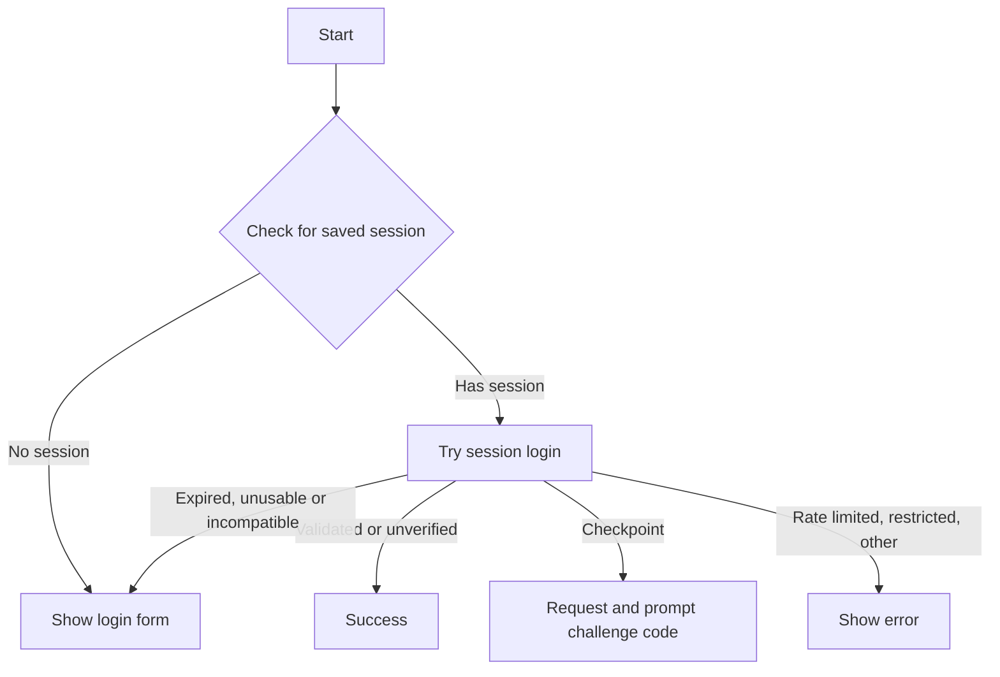
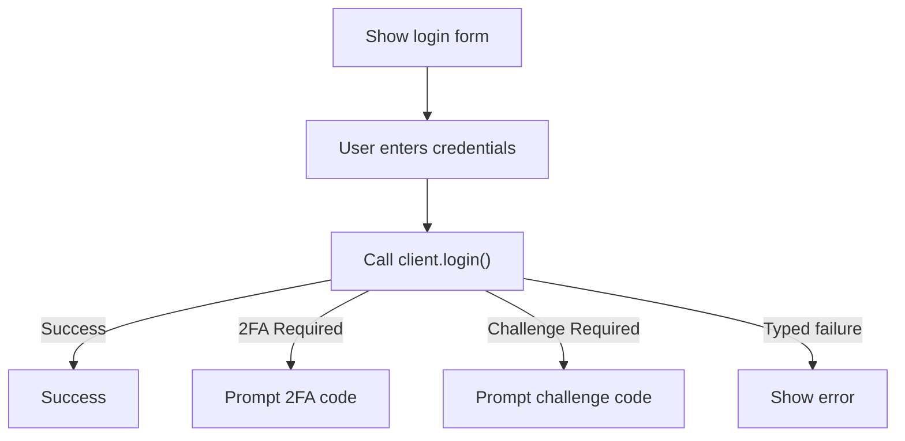
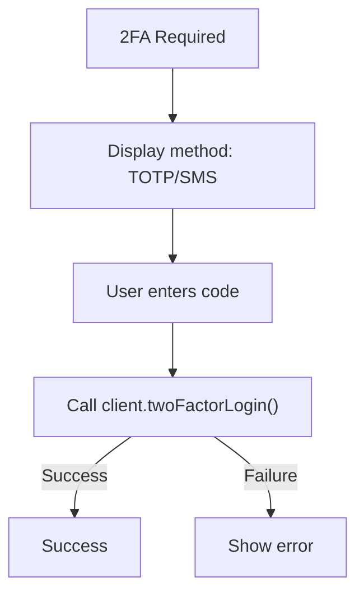
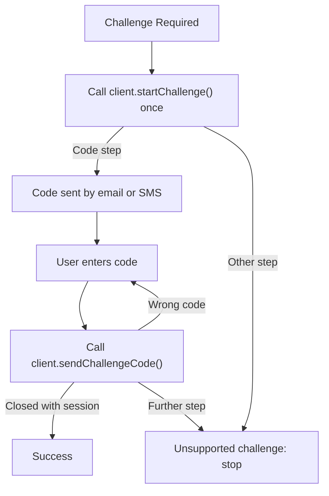

# Login Workflow Design

> Implementation reference: live authentication compatibility is currently being repaired and has not been revalidated against the current private API. Outcome types, session validation and persistence are specified in [Authentication and Session Integrity](authentication.md).

## Overview

The Instagram-CLI implements a multi-stage login flow that handles various authentication scenarios including session-based login, username/password authentication, 2FA, and challenge-based verification. The CLI UI component (`login.tsx`) drives an `AuthenticationCoordinator`, which calls the `InstagramClient` methods; each step returns a typed `AuthenticationOutcome`.

## Login Flow States

The login component (`login.tsx`) manages the following states:

- **`session`**: Attempting to login with saved session data
- **`form`**: Username/password login form
- **`code`**: Two-factor or challenge verification code input
- **`success`**: Login completed successfully (including a restored but unverified session)
- **`error`**: Login stopped with a typed outcome

The mode follows `nextAuthenticationStep(outcome)`; the message is `describeAuthenticationOutcome(outcome)`.

## Workflow Sequence

### 1. Initial Session Login (Default Flow)

### 2. Username/Password Login (Manual Flow)

When `--username` flag is provided or session login fails:

### 3. Two-Factor Authentication

### 4. Challenge Verification

## Key Components

### InstagramClient Methods

- **`login(username, password)`**: Primary credential-based login
- **`loginBySession()`**: Session restoration and validation
- **`twoFactorLogin(code, {identifier, method})`**: 2FA completion
- **`startChallenge()`**: Initiates challenge flow
- **`sendChallengeCode(code)`**: Submits challenge verification

Each returns an `AuthenticationOutcome`; none throws for an authentication result.

### Error Handling

`classifyAuthenticationError()` maps dependency errors to outcomes, for example:

- **IgLoginTwoFactorRequiredError** → `two-factor-required`
- **IgCheckpointError** → `checkpoint-required`
- **IgLoginBadPasswordError / IgLoginInvalidUserError** → `invalid-credentials`
- **IgLoginRequiredError** → `session-expired`
- **HTTP 429 / spam** → `rate-limited`
- **IgNetworkError** → `network-error` (or `incompatible-response` for an unparseable body)
- **Refused TLS certificate** → `untrusted-connection` (`certificate`, `hostname` or `handshake`); never treated as offline

Nothing is retried automatically. See [authentication.md](authentication.md#3-typed-outcomes) for the full table.

### Session Management

- Sessions stored in `~/.instagram-cli/users/{username}/session.ts.json`
- Current username tracked in config: `login.currentUsername`
- Saving starts only once a step establishes session material; failed or interrupted logins never write
- Writes are atomic and serialized per account ([details](authentication.md#5-session-persistence))

## Debug Logging

Added debug logs for non-standard login scenarios:

- 2FA requirement detection
- Challenge requirement detection
- Login failures with the outcome kind, error class and HTTP status (never response bodies)
- Everything else passes the [safe-diagnostics policy](logging.md): no credentials, codes, cookies, tokens or payloads
- Session login failures

Logs are written to `~/.instagram-cli/logs/session-{timestamp}.log`

## Configuration

Login-related config keys:

- `login.currentUsername`: Last successfully logged-in user
- `login.defaultUsername`: Default user for future sessions

## Edge Cases

- **Session expired**: Reported, file kept; the form is shown for credential login
- **Instagram unreachable**: The saved session is restored but unverified, and is not rewritten during that run
- **2FA method detection**: TOTP vs SMS based on `totp_two_factor_on`
- **Wrong challenge code**: The user may enter the code again; nothing is resent automatically
- **Repeated Enter**: Refused while a step runs, so nothing is submitted twice
- **Client cleanup**: Automatic shutdown on component unmount flushes any due session save
